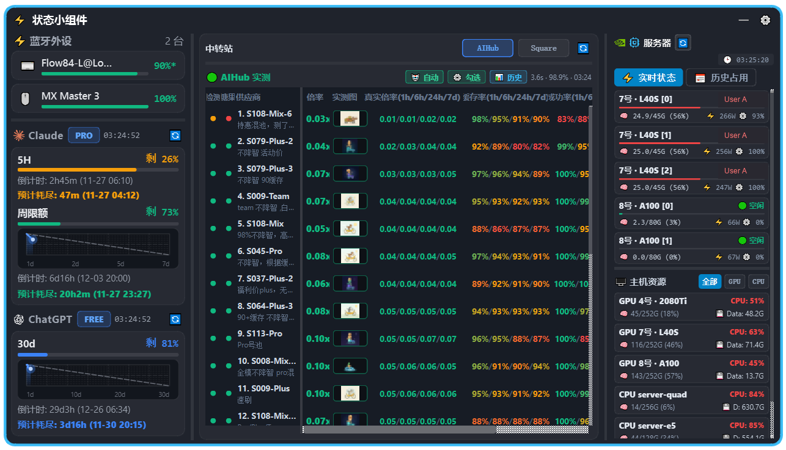
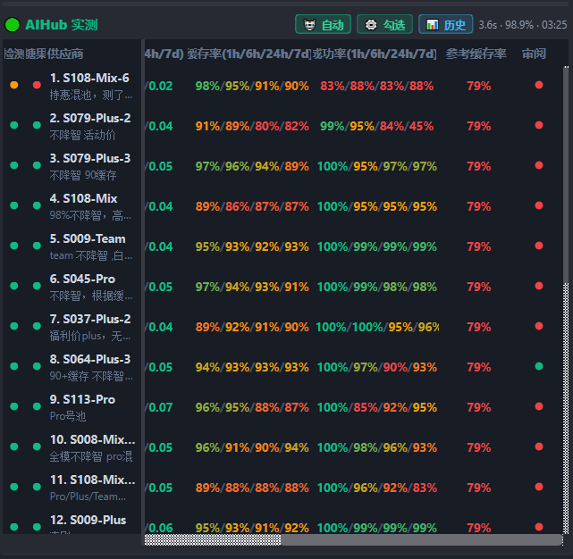
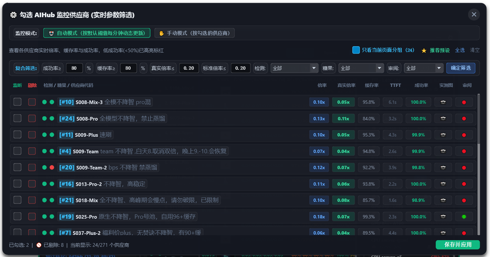
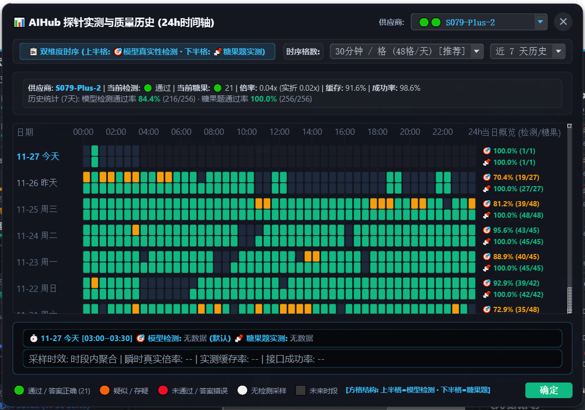
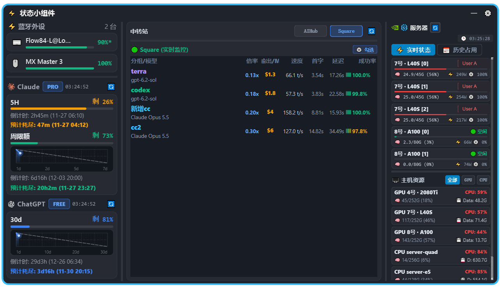
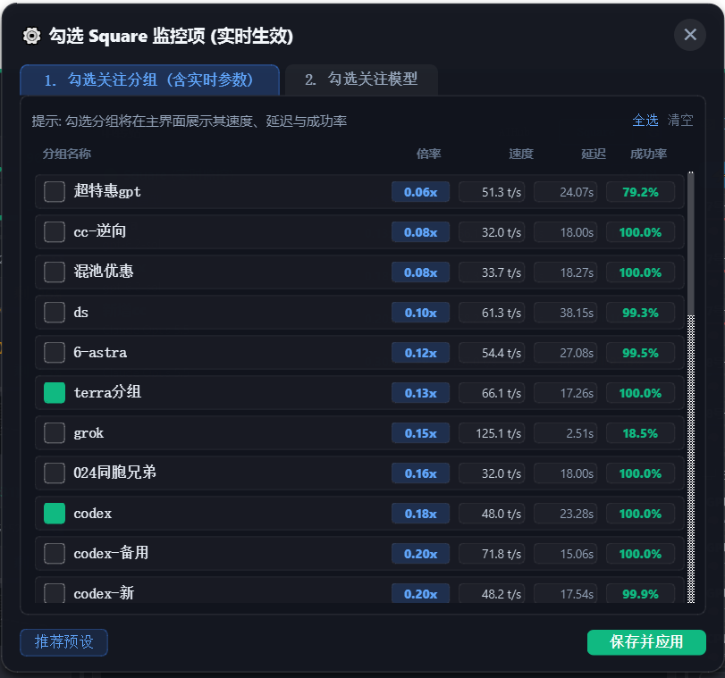
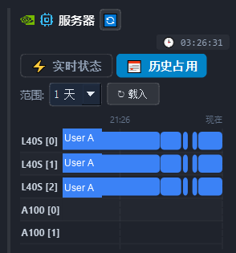

# AI Desktop Monitor

Windows 桌面悬浮监控小组件，集中查看 Claude Code、ChatGPT / Codex 额度、蓝牙电量、AI 中转站指标和远程服务器资源。

简体中文 | [English](README_en.md)



## 胶囊模式与运行状态

收起后用两行展示额度、电量、GPU 显存和服务器 CPU 指标，点击胶囊可展开。外框根据本地 Claude Code 与 Codex 的任务状态改变颜色。

| 状态 | 外框颜色 |
| --- | --- |
| 空闲 | 绿色 |
| Claude Code 正在执行任务 | 橙色 |
| Codex 正在执行任务 | 亮蓝色 |
| 两者都在执行任务 | 红色 |


活动检测读取本地会话状态，较早的 Claude Code 版本会回退读取相关会话的日志尾部。额度刷新与运行状态检测分别进行。

## 额度与蓝牙电量

- Claude Code 与 ChatGPT / Codex 分别显示套餐、剩余额度、重置倒计时和消耗趋势。
- 预计耗尽文字跟随对应进度条的颜色，预测依据本机采样历史计算。
- 自动读取本地登录信息，支持从 CC Switch 管理的 Claude Code 账号与 Codex 凭据中读取额度。
- Claude Desktop 和 Claude Code 的登录状态可能不同，请先完成 Claude Code 登录。
- 网络失败会显示最近一次成功数据及失败提示，并延迟重试。
- 蓝牙区域默认容纳两行，更多设备通过滚动查看。带 `*` 的电量表示设备处于待机状态，数值来自最近可读取的信息。
- 使用像素字体和统一缩放处理，监听显示器、DPI 和工作区变化，适用于本机及 RDP 场景。实际显示效果取决于系统缩放与远程客户端设置。

## 中转站监控

### AIHub

默认显示 AIHub 页面，可查看供应商倍率、缓存率、成功率、实测图和审阅状态。支持自动阈值筛选、手动勾选，以及多个时间范围的指标。





历史视图将模型检测与糖果题实测按时间格展示，可切换供应商和时间范围。



实测缩略图按需从网络读取，使用有界内存缓存。历史指标在本地 SQLite 中压缩保存。

### Square

切换到 Square 可查看关注分组与模型的倍率、输出价格、速度、首字延迟、总延迟和成功率。





供应商指标由对应服务提供，截图中的供应商名称保留原样。

## 服务器与历史记录

通过 SSH 采集 GPU 显存、功耗、利用率，以及主机 CPU、内存和磁盘状态。GPU 占用历史保存到本地 SQLite，可查看任务占用时间线。



服务器采集复用 SSH 连接，批量查询任务所属用户，断线后自动重连。列表复用已有行控件，活动检测增量读取日志，避免反复读取整个历史文件。进程锁防止重复启动多个悬浮窗。

## 安装与启动

需要 Windows 10 / 11 和 Python 3.8 或更高版本。蓝牙电量读取依赖设备向 Windows 提供的电量属性。远程 GPU 采集需要服务器安装 `nvidia-smi`，Linux 主机资源采集需要 `python3`。

```powershell
git clone https://github.com/Tison6/codex-usage-floating-widget.git
cd codex-usage-floating-widget
python -m pip install -r requirements.txt
python main.py
```

双击 `run.bat` 或 `run_silent.vbs` 可在后台启动，`run_debug.bat` 用于查看启动错误。右键菜单可打开偏好设置并配置开机自启。

## 本地配置

首次运行会使用默认配置。可复制 `config.example.json` 为 `config.json`，填写所需服务。示例中的服务器地址与账号均为占位信息。

| 配置项 | 用途 |
| --- | --- |
| `auth_file_path` | Codex 登录文件，默认 `~/.codex/auth.json` |
| `claude_auth_file_path` | Claude Code 登录文件，默认 `~/.claude/.credentials.json` |
| `square_api_key` | Square API 密钥，留空时尝试读取本地 CC Switch 配置 |
| `aihub_email` / `aihub_password` | AIHub 登录信息 |
| `servers` | Windows CPU 主机连接信息 |
| `gpu_servers` | Linux GPU 主机连接信息，同时用于 GPU 与主机资源采集 |
| `gpu_db_path` | GPU 历史数据库路径，留空时使用项目目录下的 `data/gpu_history.db` |
| `scale` | 界面缩放倍率 |
| `bt_interval_sec` / `codex_interval_sec` / `claude_interval_sec` | 电量与额度刷新周期 |

GPU 服务器配置使用 `id`、`name`、`ip`、`port`、`user` 和 `key_path`。Windows 主机使用 `id`、`name`、`host`、`port`、`user` 和 `password`。`key_path` 支持 `~`。胶囊目前按固定服务器编号汇总，调整编号时也需检查胶囊对应关系。

如需将任务系统用户名显示为昵称，可在本地创建 `data/user_mapping.json`，内容为用户名到显示名称的 JSON 映射。

## 数据与截图

`config.json`、`data/`、数据库、日志和私钥文件通过 `.gitignore` 排除。额度历史、服务器记录与本机登录凭据保留在本机。截图中的个人任务用户名已替换为 `User A`，设备型号与供应商名称保留，PNG 重新编码以去除来源元数据。

公开历史已于 2026-11-27 从脱敏后的当前版本重建。曾曝光的密码仍需更换，旧克隆、fork 和 GitHub 缓存仍可能保留旧内容。

执行 `git config core.hooksPath .githooks` 启用本地提交检查。发布前执行 `python scripts/check_public_content.py --all`，GitHub Actions 也会检查跟踪文件。截图需人工脱敏，真实凭据仅放在已忽略的本地配置中。本地检查可被跳过，CI 在推送后运行，误传的凭据必须更换。

## License

[MIT](LICENSE)
