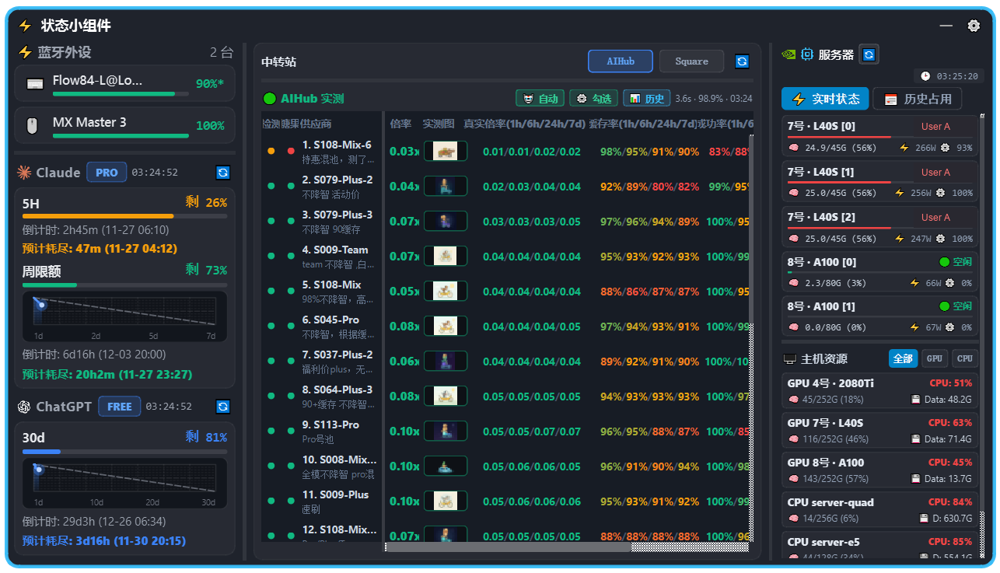
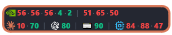
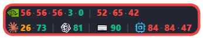
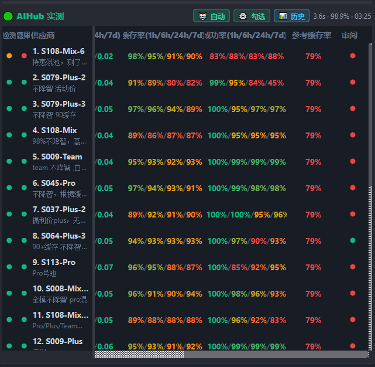
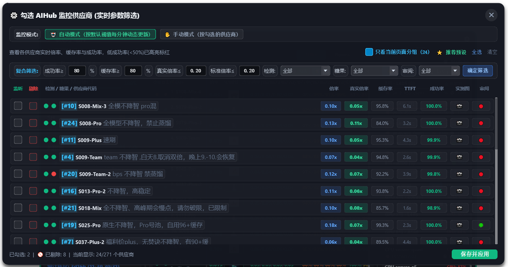
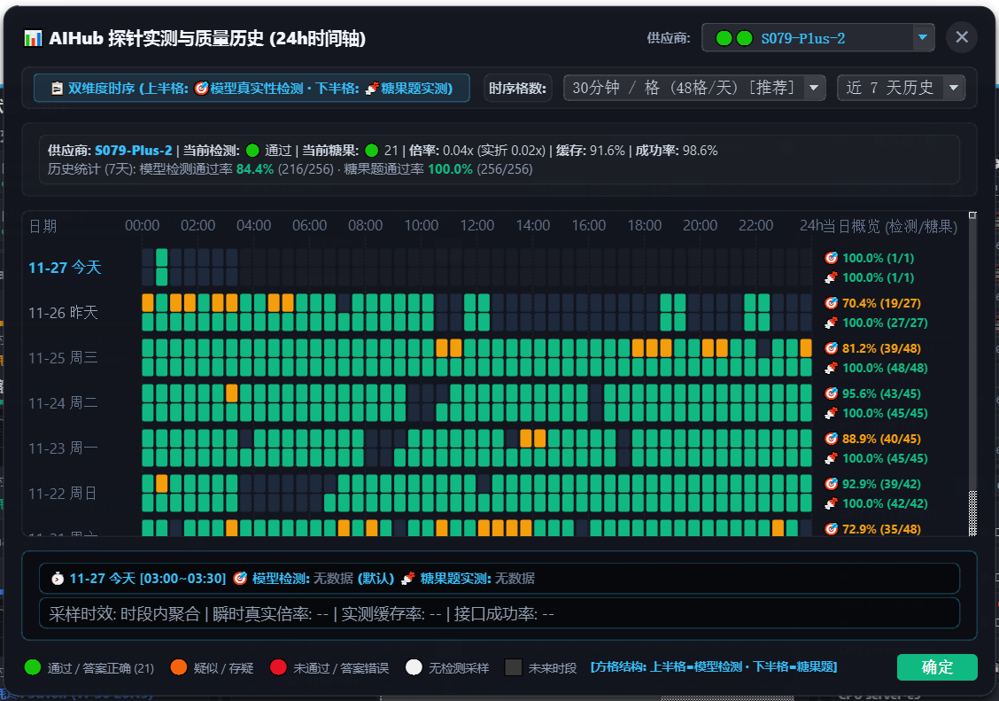
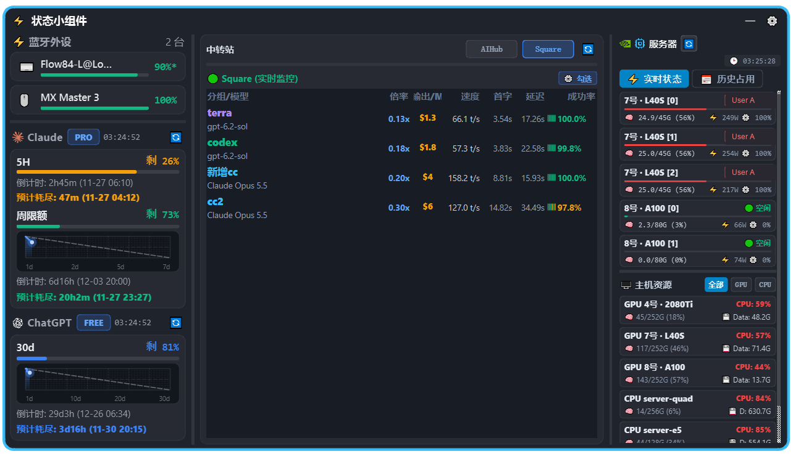
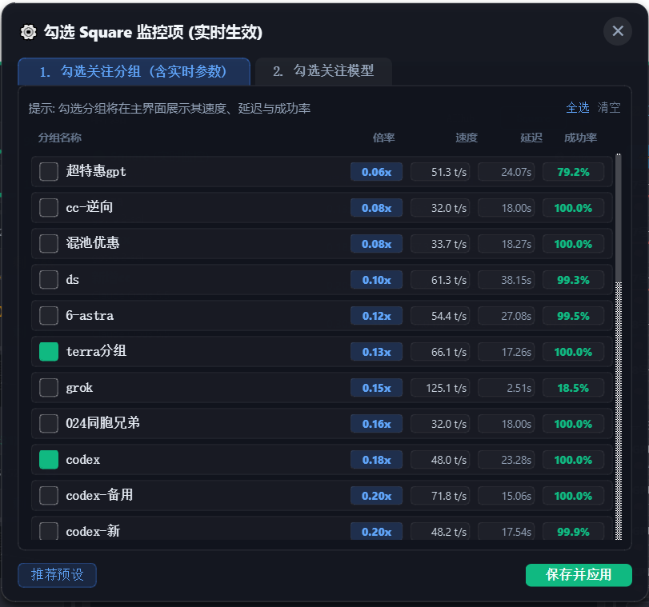
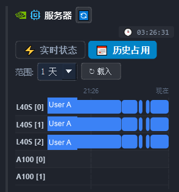

# AI Desktop Monitor

A floating Windows dashboard for Claude Code and ChatGPT / Codex quotas, Bluetooth battery levels, AI relay metrics, and remote server resources.

[简体中文](README.md) | English



## Capsule and activity indicators

The two-row capsule summarizes quotas, battery levels, GPU memory, and server CPU usage. Click it to expand the dashboard.

| Local task activity | Border |
| --- | --- |
| Idle | Green |
| Claude Code running | Orange |
| Codex running | Blue |
| Both running | Red |







Activity detection reads local session state. Older Claude Code sessions fall back to a bounded log tail. Quota polling runs separately.

## Quotas and battery levels

- Separate Claude Code and ChatGPT / Codex quota cards with plan, remaining allowance, reset countdown, trends, and exhaustion estimates based on local samples.
- Prediction text follows the corresponding progress bar color.
- Reads local login files and supports credentials managed by CC Switch. Claude Desktop and Claude Code can have different login states, so sign in to Claude Code first.
- Retains the last successful quota reading during network failures, shows the failure, and backs off retries.
- Shows two Bluetooth rows with scrolling for additional devices. An asterisk marks a standby device with its latest available battery reading.
- Uses consistent pixel fonts and responds to display, DPI, and work-area changes. RDP appearance also depends on Windows and client display settings.

## AI relay monitoring

AIHub opens by default and displays provider multipliers, cache ratios, success rates, test images, and review status. Automatic thresholds and manual selection are supported.





Model verification and candy-test history can be explored by provider and time range.



The history timeline shows the selected provider description and an exclusion checkbox. Exclusions apply in automatic and manual modes and can be unchecked to restore the provider. Test images load after clicking View. The image viewer uses a bounded memory cache. Historical metrics use compressed local SQLite storage.

Square displays selected groups and models with pricing multipliers, output prices, speed, time to first token, latency, and success rate.





Metrics come from the respective services. Provider names remain visible in the screenshots.

## Servers and history

SSH collectors report GPU memory, power, utilization, and host CPU, RAM, and disk metrics. Local SQLite history supports a GPU occupancy timeline.



Collectors reuse SSH connections, batch process-owner queries, and reconnect after failures. The UI reuses rows and activity detection reads incremental log updates. A process lock prevents duplicate widget instances.

## Install and run

Requires Windows 10 / 11 and Python 3.8 or newer. Battery availability depends on the properties exposed by each device to Windows. Remote GPU monitoring requires `nvidia-smi`, and Linux host monitoring requires `python3`.

```powershell
git clone https://github.com/Tison6/codex-usage-floating-widget.git
cd codex-usage-floating-widget
python -m pip install -r requirements.txt
python main.py
```

Use `run.bat` or `run_silent.vbs` for background startup and `run_debug.bat` for startup diagnostics. Preferences are available from the context menu, including Windows autostart.

## Local configuration

Copy `config.example.json` to `config.json` and fill in the services you need. Example hosts and accounts are placeholders.

| Key | Purpose |
| --- | --- |
| `auth_file_path` | Codex login file, defaults to `~/.codex/auth.json` |
| `claude_auth_file_path` | Claude Code login file, defaults to `~/.claude/.credentials.json` |
| `square_api_key` | Square API key, with local CC Switch fallback when empty |
| `aihub_email` / `aihub_password` | AIHub credentials |
| `servers` | Windows CPU host connections |
| `gpu_servers` | Linux GPU host connections used by both GPU and host collectors |
| `gpu_db_path` | GPU history path, defaults to `data/gpu_history.db` inside the project |
| `scale` | UI scale |
| `bt_interval_sec` / `codex_interval_sec` / `claude_interval_sec` | Battery and quota polling intervals |

GPU entries use `id`, `name`, `ip`, `port`, `user`, and `key_path`. Windows host entries use `id`, `name`, `host`, `port`, `user`, and `password`. SSH key paths support `~`. The capsule currently summarizes fixed server IDs, so check its mappings when changing IDs.

An optional local `data/user_mapping.json` maps system usernames to display aliases.

## Local data and screenshots

`.gitignore` excludes `config.json`, `data/`, databases, logs, and private-key files. Quota history, server records, and login credentials stay on the local machine. Personal task usernames in the screenshots have been replaced with `User A`. Device models and provider names are retained. PNG files have been re-encoded without source metadata.

The public history was rebuilt from the sanitized current tree on 2026-11-27. Previously exposed credentials still require rotation. Old clones, forks, and GitHub cached views may retain earlier content.

Enable local checks with `git config core.hooksPath .githooks`. Run `python scripts/check_public_content.py --all` before publishing. GitHub Actions also checks tracked files. Review screenshots manually and keep real credentials in ignored local configuration. Hooks can be bypassed and CI runs after a push, so rotate any credential that is accidentally published.

## License

[MIT](LICENSE)
