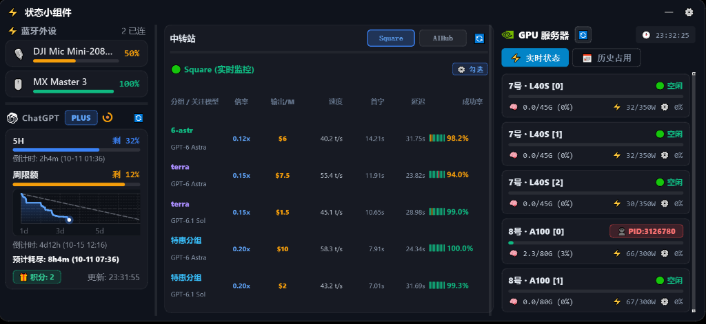
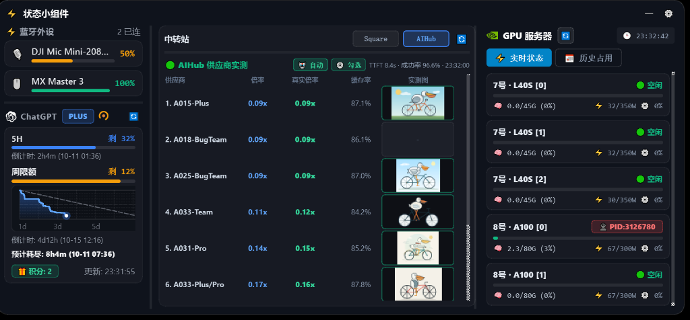
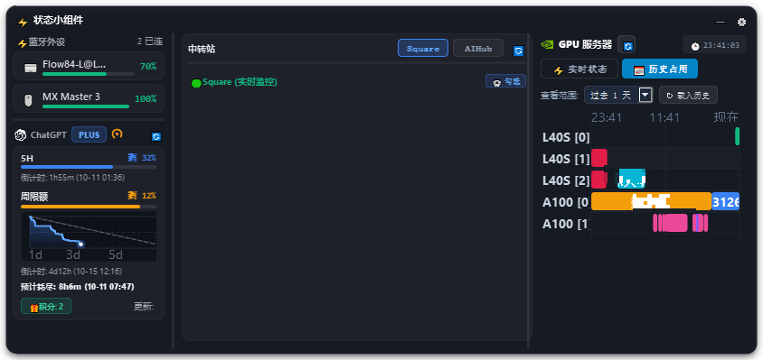
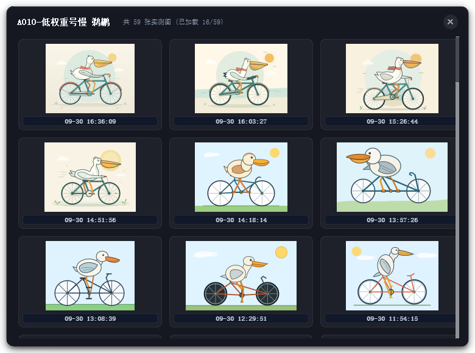

<div align="center">

# ⚡ Codex Vibe Monitor
### A Vibe-Coding Companion for Windows: Real-Time Bluetooth Battery, ChatGPT/Codex Quotas, AI Relay Benchmarks & GPU Cluster Monitoring

[](LICENSE)
[](https://www.python.org/)
[](https://www.microsoft.com/windows)
[](https://riverbankcomputing.com/software/pyqt/)

[简体中文](README.md) | English

<br/>

<p align="center">
  
</p>
<p align="center">
  <em>💊 Mini Capsule Mode (Zero-% dot-connected metrics, unbolded 9px modern font, symmetric 2-row 6-unit layout, instant click-to-expand)</em>
</p>

<p align="center">
  
</p>
<p align="center">
  <em>⚡ Expanded 3-Column Card (Square API Tab): Left column for Bluetooth peripherals + 7-Day burn rate sparkline, middle column for Square API 24h official benchmarks & pricing, right column for live GPU cluster status</em>
</p>

<p align="center">
  
</p>
<p align="center">
  <em>🟢 Expanded 3-Column Card (AIHub Tab): Real multiplier, cache hit rate ranking, embedded live Pelican verification thumbnails, auto/manual filter toggle</em>
</p>

<p align="center">
  
</p>
<p align="center">
  <em>📊 GPU History Gantt Chart: 24h / 7-Day multi-card historical timeline, non-overlapping timestamps, task user & PID hover tooltips</em>
</p>

<p align="center">
  
</p>
<p align="center">
  <em>🎨 Online Pelican Verification Gallery: 3-column responsive layout, live dynamic fetch, timestamps, and zero-disk in-memory rendering</em>
</p>

</div>

---

## 💡 Why This Widget? (The Vibe Coding Story)
When pairing wireless microphones such as the **DJI Mic Mini** or **DJI Mic** for **Vibe Coding** (voice-driven programming, AI dictation, and autonomous agent collaboration) alongside ChatGPT / OpenAI Codex, developers encounter four core pain points:
1. **Microphone Battery Anxiety**: Mid-thought dictation is abruptly broken when the wireless microphone unexpectedly runs out of power.
2. **Opaque Rate Limits & Burn Rate**: Uncertainty about remaining 5-hour rolling windows and 7-day weekly quotas, lacking a visible pace guide.
3. **Relay Provider Transparency & Model Degradation ("降智")**: Third-party relay stations often obfuscate real rate multipliers, suffer from high TTFT latencies, and risk model downgrading (unverified whether they pass the canonical "Pelican on a Bicycle" SVG benchmark).
4. **GPU Cluster Blind Spot**: Inability to quickly glance at remote GPU cluster VRAM, power consumption, and task queues from the desktop.

**`codex-usage-floating-widget`** solves all these challenges with an elegant, ultra-compact, dark-acrylic desktop companion.

---

## ✨ Key Features

### 1. 💊 Ultra-Compact Mini Capsule Mode
- **Zero-% Minimalist Aesthetics**: Strips all redundant `%` signs, connecting values with elegant semi-transparent dots `·`;
- **Modern Unbolded Typography**: Uses clean `9px` regular weight typography without bulky bold fonts;
- **High-Density Symmetric 6-Unit Layout**:
  - **Row 1**: `🎙️ 50 | 🟩 0 · 0 · 0 · 3 · 0` (Pinned microphone battery + NVIDIA 5-card GPU VRAM quick glance);
  - **Row 2**: `🌸 32 · 12 🟠 | 🔲 35 · 29 · 1` (ChatGPT 5H & Weekly quota colors + 3-server CPU utilization);
- **Ultra-Tight Bounding Box**: Scaled dynamically (only `152px` wide and `35px` high at scale `0.8`), zero excess gap on the right;
- **Seamless Interaction**: Click anywhere on the capsule to instantly expand; drag from any blank area to snap to screen edges.

### 2. 🎙️ Vibe-Coding Peripheral Radar
- **Pinned DJI Microphone Priority**:
  - When a **DJI Mic Mini** or **DJI Mic** is connected, its battery is **strictly pinned to the front** of the mini capsule;
  - If no DJI microphone is connected, falls back to monitoring whichever connected peripheral has the **lowest battery percentage**;
- **Native Hardware Access (< 15ms, 0% CPU)**:
  - Direct calls to Windows `SetupAPI` and `CfgMgr32` via Python `ctypes`, querying standard Bluetooth Battery Service (GATT Profile);
  - Zero background daemon overhead, zero polling lag;
  - Supports DJI Mics, mechanical keyboards (NuPhy, Keychron, Lofree Flow), mice (Logitech MX Master/Anywhere), headsets (Sony WH/WF series), and more.

### 3. 🤖 ChatGPT Plus / Codex Quota & State Tracker
- **Zero-Config Token Sync**:
  - Reads `%USERPROFILE%\.codex\auth.json` directly. Stays synchronized with your Codex CLI / ChatGPT Desktop session without manually inputting API tokens;
- **CC Switch Conflict Resilience**:
  - Automatically queries `%USERPROFILE%\.cc-switch\cc-switch.db` as fallback, keeping official Codex quotas active regardless of third-party API toggles;
- **7-Day Sparkline Grid & Burn Rate Prediction**:
  - Normalized grid with 7-day scale ticks (`1d`, `3d`, `5d`, `7d`);
  - Ideal uniform burn diagonal baseline (100% to 0%) for instant pacing evaluation;
  - Time remaining countdown and predicted depletion time calculated down to the exact minute;
- **Turn Lifecycle State Machine**:
  - Native state machine tracking (`task_started` → `task_complete` / `turn_aborted`);
  - Glowing spinner (🟠 Running) during reasoning/tool calls; smooth emerald breathing light (🟢 Ready) upon completion.

### 4. 🌐 AI Relay Monitoring & Pelican Verification Gallery
- **Square API 24h Real-Time Benchmarks**:
  - Live benchmark crawler for Square API pricing & models (`api.squarefaceicon.org`);
  - Displays: Model group, multiplier, effective output token cost ($/M), generation speed (t/s), TTFT latency, total latency, and success rate progress bar;
  - Multi-model group row expansion with customizable model and group filters;
- **AIHub Provider Benchmarks & Pelican Previews**:
  - Real-time multiplier and cache hit rate tracking with live Pelican test thumbnails;
  - Automatic filtering mode and manual selection mode toggle;
- **Online Pelican Test Gallery Dialog**:
  - 3-column responsive gallery dialog for historical SVG drawings;
  - Decoded asynchronously in-memory with zero disk clutter.

### 5. 🖥️ GPU Cluster Monitor & History Gantt Chart
- **5 High-Performance GPUs Live Monitor (7号 L40S ×3 · 8号 A100 ×2)**:
  - Real-time VRAM usage (GB / %), power draw vs TDP limit (W), and core utilization;
  - Active user identity and process PID tags at a glance;
  - Three-tier color thresholds (<10% Green / 10%~30% Orange / ≥30% Red alert);
- **24-Hour / 7-Day History Gantt Chart**:
  - Reconstructs historical GPU occupancy intervals by user and card;
  - Hover tooltips with detailed memory and task metrics.

---

## 🚀 Quick Start

### Prerequisites
- Operating System: Windows 10 / 11 (64-bit)
- Python: Version 3.8 or higher

### Installation
```bash
# 1. Clone repository
git clone https://github.com/Tison6/codex-usage-floating-widget.git
cd codex-usage-floating-widget

# 2. Install dependencies
pip install -r requirements.txt

# 3. Launch widget
python main.py
```

### Background Execution & Autostart
- Run **`run_silent.vbs`** to launch silently in the background without any command prompt window;
- Right-click widget -> **Settings** to enable **"Run on Windows Startup"**.

---

## 🔒 Privacy & Security

This project strictly adheres to **Zero Privacy Leakage** principles:
- **No Credentials in Repository**: No private API keys, OAuth tokens, passwords, or internal network IPs are committed;
- **Isolated Configuration**: Sensitive configurations are stored locally in `config.json` and `data/`, fully excluded by `.gitignore`;
- **Local User Mapping**: Username-to-display mappings are stored locally in `data/user_mapping.json` and never pushed to public repositories.

---

## 📄 License

This project is licensed under the [MIT License](LICENSE).
